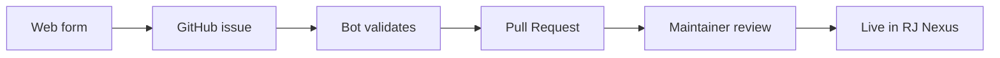

<div align="center">

# Contributing to the RJ Nexus Registry

Publish your theme or plugin to the official RJ Nexus registry in a few minutes.

<br>

<a href="https://rj-nexus.github.io/rj-registration/">
  
</a>

<br>
<br>

<sub>Fastest way: fill in the form, a bot validates it and opens the Pull Request for you.</sub>

<br>
<br>


</div>

---

## How it works



---

## Contents

- [Before you submit](#before-you-submit)
- [1. Prepare your repository](#1-prepare-your-repository)
- [2. Create a GitHub release](#2-create-a-github-release)
- [3. Submit with the web form](#3-submit-with-the-web-form)
- [4. Submit with a Pull Request](#4-submit-with-a-pull-request)
- [Image hosting](#image-hosting)
- [Review process](#review-process)
- [After approval](#after-approval)
- [Changing metadata](#changing-metadata)
- [Removal](#removal)
- [Code of conduct](#code-of-conduct)
- [Questions](#questions)

---

## Before you submit

Make sure you have:

- [ ] A **public GitHub repository** with your theme or plugin
- [ ] A valid `theme.json` or `plugin.json` at the repository root
- [ ] At least **one published GitHub release** with a ZIP asset
- [ ] An **open-source license** (MIT, GPL, Apache, BSD, etc.)
- [ ] A working `README.md`
- [ ] A logo or at least one screenshot (hosted URL, see [Image hosting](#image-hosting))

> [!IMPORTANT]
> If any of these are missing, the submission will be closed.

---

## 1. Prepare your repository

<details open>
<summary><strong>Theme layout</strong></summary>

```text
your-theme/
├── theme.json
├── README.md
├── LICENSE
├── screenshot.png
├── views/
│   ├── layout.blade.php
│   ├── single-post.blade.php
│   ├── single-page.blade.php
│   └── archive.blade.php
└── assets/
    ├── css/
    └── js/
```

</details>

<details>
<summary><strong>Plugin layout</strong></summary>

```text
your-plugin/
├── plugin.json
├── README.md
├── LICENSE
├── src/
│   └── Plugin.php
└── assets/
```

</details>

<details>
<summary><strong><code>theme.json</code> example</strong></summary>

```json
{
    "name": "Your Theme Name",
    "slug": "your-theme-slug",
    "version": "1.0.0",
    "author": "Your Name",
    "author_url": "https://example.com",
    "description": "A short description of your theme.",
    "requires": {
        "rj_cms": ">=1.0.0",
        "php": ">=8.2"
    },
    "supports": {
        "builder_header": true,
        "builder_footer": true,
        "builder_page": true
    }
}
```

</details>

<details>
<summary><strong><code>plugin.json</code> example</strong></summary>

```json
{
    "name": "Your Plugin Name",
    "slug": "your-plugin-slug",
    "version": "1.0.0",
    "author": "Your Name",
    "author_url": "https://example.com",
    "description": "A short description of your plugin.",
    "requires": {
        "rj_cms": ">=1.0.0",
        "php": ">=8.2"
    },
    "hooks": {
        "activate": "YourVendor\\YourPlugin\\Plugin::activate",
        "deactivate": "YourVendor\\YourPlugin\\Plugin::deactivate"
    }
}
```

</details>

> [!NOTE]
> The `slug` must be unique. Matching your repository name is recommended, but not required.

---

## 2. Create a GitHub release

1. Open your repository on GitHub.
2. Click **Releases**, then **Draft a new release**.
3. Create a tag such as `v1.0.0`. It must match the `version` in your manifest.
4. Set a title, for example `Your Theme 1.0.0`.
5. Describe what changed in this version.
6. Attach a ZIP file with your theme or plugin.
7. Click **Publish release**.

### ZIP requirements

- The manifest (`theme.json` or `plugin.json`) must be at the root or one level deep.
- The file must be under **50 MB**.
- The file name is flexible (`theme.zip`, `your-theme-1.0.0.zip`, and so on).

### Accepted and rejected structures

| Structure | Result |
|---|---|
| `your-theme.zip` → `theme.json`, `views/`, `assets/` | ✅ Accepted (flat) |
| `your-theme.zip` → `your-theme/` → `theme.json`, `views/`, `assets/` | ✅ Accepted (one wrapper folder) |
| `your-theme.zip` → `src/` → `your-theme/` → `theme.json` | ❌ Rejected (nested too deep) |

---

## 3. Submit with the web form

The fastest way to submit is the official form.

<div align="center">

<a href="https://rj-nexus.github.io/rj-registration/">
  
</a>

</div>

1. Fill in the fields: repository, type, category, name, version, author, tags, logo, screenshots, description, features, installation steps, requirements, docs URL.
2. Click **Continue on GitHub**.
3. A prefilled issue opens. Review it and click **Submit new issue**.
4. A bot validates your submission and opens a Pull Request automatically.
5. Maintainers review and merge the Pull Request.

> [!TIP]
> You do not need to fork the repository or edit any JSON when you use the form.

---

## 4. Submit with a Pull Request

Prefer the manual route? Follow these steps.

1. Fork [`rj-nexus/rj_cms_theme_and_plugin_list`](https://github.com/rj-nexus/rj_cms_theme_and_plugin_list).
2. Add your entry to `themes.json` or `plugins.json` (never to `registry.json`).
3. Update `count` and `updated_at` in `registry.json`.
4. Open a Pull Request. CI validates the schema, duplicates, and your repository manifest.

<details>
<summary><strong>Theme entry example (<code>themes.json</code>)</strong></summary>

```json
{
    "repo": "your-username/your-theme",
    "name": "Your Theme Name",
    "author": "your-username",
    "version": "1.0.0",
    "verified": false,
    "featured": false,
    "category": "blog",
    "tags": ["minimal", "responsive"],
    "logo": "https://example.com/logo.png",
    "screenshots": [
        "https://example.com/shot1.png",
        "https://example.com/shot2.png"
    ],
    "details": {
        "description": "A short description of your theme.",
        "features": [
            "Minimal and clean design",
            "Fully responsive",
            "RJBuilder ready"
        ]
    },
    "installation": {
        "steps": [
            "Download the ZIP from the releases page",
            "Go to Admin → Appearance → Themes",
            "Upload the ZIP file",
            "Click Activate"
        ]
    },
    "development": {
        "requires": "RJ Nexus >= 1.8.0",
        "docs": "https://github.com/your-username/your-theme#readme"
    }
}
```

</details>

<details>
<summary><strong>Plugin entry example (<code>plugins.json</code>)</strong></summary>

```json
{
    "repo": "your-username/your-plugin",
    "name": "Your Plugin Name",
    "author": "your-username",
    "version": "1.0.0",
    "verified": false,
    "featured": false,
    "category": "seo",
    "tags": ["meta", "sitemap"],
    "logo": "https://example.com/logo.png",
    "screenshots": [],
    "details": {
        "description": "A short description of your plugin.",
        "features": [
            "Meta tag editor",
            "XML sitemap generation"
        ]
    },
    "installation": {
        "steps": [
            "Download the ZIP from the releases page",
            "Go to Admin → Plugins → Upload Plugin",
            "Select the ZIP and click Upload",
            "Click Activate next to the plugin"
        ]
    },
    "development": {
        "requires": "RJ Nexus >= 1.8.0, PHP >= 8.2",
        "docs": "https://github.com/your-username/your-plugin#readme"
    }
}
```

</details>

> [!WARNING]
> Always submit with `"verified": false` and `"featured": false`. Maintainers set these flags after review.

### Allowed categories

| Type | Categories |
|---|---|
| Themes | `general` `blog` `portfolio` `business` `ecommerce` `landing` `agency` `other` |
| Plugins | `general` `ecommerce` `forms` `seo` `marketing` `analytics` `security` `media` `social` `developer` `other` |

If your package does not fit any category, use `other`.

### Schema references

- [`schema/registry.schema.json`](schema/registry.schema.json)
- [`schema/theme.schema.json`](schema/theme.schema.json)
- [`schema/plugin.schema.json`](schema/plugin.schema.json)

---

## Image hosting

Logos and screenshots must be direct `https://` URLs. These services need no account:

| Service | Link |
|---|---|
| freeimage.host | https://freeimage.host |
| imgbb | https://imgbb.com |
| postimages | https://postimages.org |
| mini-tools | https://mini-tools.uk |

GitHub raw URLs, your own CDN, Imgur, or any other direct HTTPS image URL also work.

---

## Review process

### Automatic validation

Runs when a submission arrives as an issue or a Pull Request.

- [x] JSON files are valid
- [x] Schema validation passes (`registry.json`, `themes.json`, `plugins.json`)
- [x] No duplicate `repo` entries
- [x] `registry.json` counts match the length of `themes.json` and `plugins.json`
- [x] Your repository is public and accessible
- [x] Your repository has a valid manifest at the root
- [x] The manifest `name` matches the registry entry `name`

### Manual review

Once validation passes, a maintainer checks the package.

- [x] Code quality is reasonable
- [x] No malicious code
- [x] `README.md` is present
- [x] License file is present
- [x] Logo or screenshots are present
- [x] Installation steps are accurate

Typical review time is **1 to 7 days**. When everything checks out, your package gets `"verified": true` and appears in the RJ Nexus admin panel.

---

## After approval

You do not need new Pull Requests for new versions. Publish a new GitHub release instead.

1. Update `version` in `theme.json` or `plugin.json`.
2. Commit the change.
3. Create a new release (tag `v1.1.0`, and so on).
4. Attach the new ZIP.

RJ Nexus detects the update within 12 hours, or immediately when a user clicks **Check for updates**.

---

## Changing metadata

Open a new Pull Request if you need to:

- Change the category or tags
- Update the logo or screenshots
- Update the repository URL (for example, a move from a personal account to an organization)
- Request removal

---

## Removal

To remove your package, open a Pull Request that deletes your entry from `themes.json` or `plugins.json` and updates `count` in `registry.json`. Mention the reason in the description.

Maintainers may also remove packages that:

- Have deleted or private repositories
- Contain malicious code
- Violate the license requirement
- Have been inactive for more than 2 years

---

## Code of conduct

- Be respectful.
- No spam or self-promotion without a real product.
- No packages that exist only to collect user data.
- No obfuscated code.
- No paid-only packages. Freemium is fine if the base version is free.

---

## Questions

- Open an issue: [github.com/rj-nexus/rj_cms_theme_and_plugin_list/issues](https://github.com/rj-nexus/rj_cms_theme_and_plugin_list/issues)
- Start a discussion in GitHub Discussions

<div align="center">

<br>

Every contribution makes RJ Nexus better for everyone. Thank you for your time and effort.

</div>
