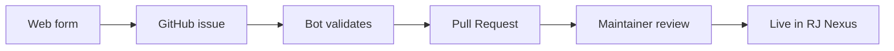

# RJ Nexus — Theme & Plugin Registry

The official registry of themes and plugins for [RJ Nexus](https://github.com/rj-nexus/rj-nexus).

 

 
 

No fork and no JSON editing. Fill in the form and a bot opens the Pull Request for you.

 
 

---

## Overview

RJ Nexus reads this registry from the admin panel:

- **Appearance → Themes → Browse**
- **Plugins → Browse**

Anything merged here becomes available to every RJ Nexus installation on its next registry refresh.

---

## Submit a theme or plugin

### Option 1: Web form (recommended)

1. Open the form and fill in the fields.
2. Click **Continue on GitHub**. A prefilled issue opens.
3. Click **Submit new issue**.
4. A bot validates the submission and opens a Pull Request automatically.

### Option 2: Manual Pull Request

1. Fork this repository.
2. Add your entry to `themes.json` or `plugins.json` (see the matching schema in `schema/`).
3. Update `count` and `updated_at` in `registry.json`.
4. Open a Pull Request. CI validates the schema, duplicates, and your repository manifest.

> [!TIP]
> Full step-by-step instructions, ZIP rules, and entry examples are in [CONTRIBUTING.md](CONTRIBUTING.md).

---

## Entry requirements

| Requirement | Details |
|---|---|
| Repository | Must be **public** on GitHub |
| Manifest | `theme.json` or `plugin.json` at the repository **root** |
| Manifest fields | Valid `name` and `version` |
| Name match | Manifest `name` must match the registry entry `name` |
| Images | Logos and screenshots must be direct `https://` URLs |
| Tags | Lowercase, hyphen-separated, max 8 |
| Category | Must be a value from the schema enum |

---

## Image hosting

No account is required for these services:

| Service | Link |
|---|---|
| freeimage.host | https://freeimage.host |
| imgbb | https://imgbb.com |
| postimages | https://postimages.org |
| mini-tools | https://mini-tools.uk |

Any direct HTTPS URL also works: GitHub raw, your own CDN, Imgur, and so on.

---

## Review process

| Step | What happens |
|---|---|
| 1 | The submission arrives as a GitHub issue |
| 2 | The bot validates the payload and the target repository manifest |
| 3 | The bot opens a Pull Request with the new entry (`verified: false`, `featured: false`) |
| 4 | CI validates the Pull Request again |
| 5 | Maintainers review and merge |
| 6 | RJ Nexus clients pick up the update on the next registry refresh |

> [!NOTE]
> The `verified` and `featured` flags are set by maintainers after review.

---

## Repository structure

| File | Purpose |
|---|---|
| `registry.json` | Index with pointers, counts, and timestamps |
| `themes.json` | All approved themes |
| `plugins.json` | All approved plugins |
| `schema/` | JSON Schemas used for validation |
| `index.html` | GitHub Pages submission form |
| `.github/workflows/` | CI validation and issue-to-PR automation |

### Schemas

- [`schema/registry.schema.json`](schema/registry.schema.json)
- [`schema/theme.schema.json`](schema/theme.schema.json)
- [`schema/plugin.schema.json`](schema/plugin.schema.json)

---

## License

Released under the [MIT License](LICENSE).

 

